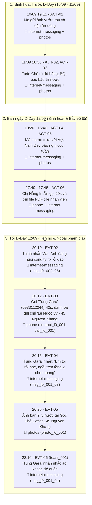
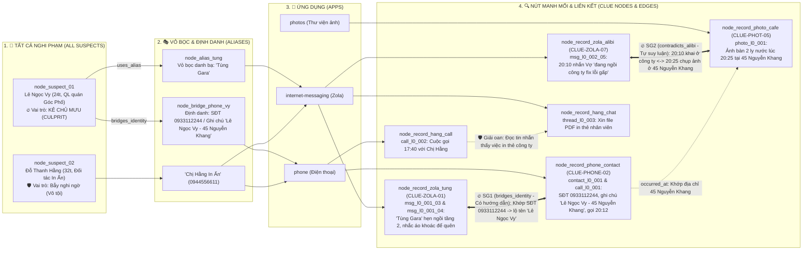

# Storyboard & Sơ đồ Pháp y - Màn 0 (Hướng dẫn): Bữa cà phê tăng ca

> **Thẩm quyền Tác giả**: Được thiết kế bởi `level-designer`. Tái sử dụng hồ sơ gốc tại [husband-profile.md](husband-profile.md). Đây là màn hướng dẫn (Tutorial) ngắn, dễ, dùng đúng 3 ứng dụng đã hoàn thiện (`internet-messaging`, `phone`, `photos`), không có khóa bảo mật, kết hợp popup hướng dẫn từng bước và tách biệt hoàn toàn với cốt truyện Màn 1 (Hương / "Khoa BE").

---

## 0. Ý tưởng Màn chơi (Design Pitch)

- **Mục tiêu hướng dẫn**: Giúp người chơi mới làm quen trọn vẹn 4 thao tác cốt lõi trong 2-3 phút: **Mở ứng dụng -> Nhấn giữ để ghim bằng chứng -> Nối dây trong Sổ tay -> Đối chất**.
- **Bối cảnh tiền truyện (không spoil Màn 1)**: 22:15 thứ Bảy 12/09/2026 (trước Màn 1 hơn 1 tháng). Thịnh vừa về nhà sau khi báo vợ "ngồi công ty fix lỗi gấp". Anh ra bếp uống nước, để điện thoại trên bàn phòng khách. Màn hình hiện một thông báo ngắn gọn từ **"Tùng Gara"** nhắc chuyện để quên áo khoác.
- **Cấu trúc 2 mối nối gọn gàng, gián tiếp**:
  1. **Mối nối 1 (Có popup hướng dẫn)**: Ghim tin nhắn từ **"Tùng Gara"** trong `internet-messaging` + ghim thẻ danh bạ **"Tùng Gara"** (còn sót ghi chú *"Lê Ngọc Vy - 45 Nguyễn Khang"*) trong `phone` -> nối dây để lột mặt nạ vỏ bọc.
  2. **Mối nối 2 (Người chơi tự suy luận)**: Ghim lời khai ngoại phạm *"Anh đang ngồi công ty fix lỗi gấp"* (20:10) trong `internet-messaging` + ghim bức ảnh chụp bàn 2 ly nước tại **Góc Phố Coffee - 45 Nguyễn Khang** lúc `20:25` trong `photos` -> nối dây để bóc trần lời nói dối -> bấm **Đối chất**.

---

## 1. Hồ sơ Nhân khẩu học Nghi phạm & Nhân vật Trong Màn (Suspect & Cast Personas)

*Kế thừa chân dung chồng Thịnh (31 tuổi), vợ Thư (28 tuổi) và dàn nhân vật cố định từ [husband-profile.md](husband-profile.md). Toàn bộ lời thoại tiếng Việt tuân thủ chuẩn xưng hô theo đúng độ tuổi và vai vế với Thịnh (31 tuổi):*

| ID Nhân vật / Nghi phạm | Họ tên Thật | Tuổi & Giới tính | Nghề nghiệp & Nhân khẩu học | Quan hệ với Chồng & Cách xưng hô chuẩn | Vỏ bọc trong máy (`alias`) | Khẩu khí & Thói quen ngôn ngữ (`chatTone`) | Vai trò trong Màn |
|---|---|---|---|---|---|---|---|
| `suspect_01` | Lê Ngọc Vy | 24 tuổi, Nữ | Quản lý ca tại quán cà phê Góc Phố (45 Nguyễn Khang, Cầu Giấy) | Nhỏ hơn Thịnh 7 tuổi; Thịnh xưng `anh`, gọi `em`; Vy xưng `em`, gọi `anh` (vẫn khớp tự nhiên với vỏ bọc thợ phụ trẻ) | `"Tùng Gara"` (`contact_l0_001`, SĐT `0933112244`) | Ngắn gọn, chừng mực, không thả thính lộ liễu (`a/e`, `nhé`, `rồi`) | **Kẻ chủ mưu (Culprit)** |
| `suspect_02` | Đỗ Thanh Hằng | 32 tuổi, Nữ | Đối tác in ấn thẻ nhân viên cho Technosoft | Lớn hơn Thịnh 1 tuổi; Thịnh bắt buộc xưng `em`, gọi `chị`; Hằng xưng `chị`, gọi `em` | `"Chị Hằng In Ấn"` (`contact_l0_002`, SĐT `0944556611`) | Lịch sự công việc, ngắn gọn, có chữ `ạ` từ Thịnh | Bẫy nghi ngờ (Red Herring - Vô tội) |
| `contact_wife` | Trần Minh Thư | 28 tuổi, Nữ | Vợ hợp pháp, kế toán | Nhỏ hơn Thịnh 3 tuổi; `anh` - `em` | `"Vợ"` (`contact_010`, SĐT `0900112233`) | Quan tâm, nhắc chồng ăn uống | Nhân vật mỏ neo (người chơi) |
| `contact_mom` | Nguyễn Thị Hòa | 56 tuổi, Nữ | Mẹ ruột Thịnh ở quê | Bề trên; Thịnh xưng `con`, gọi `mẹ` | `"Mẹ Ở Quê"` (`contact_003`, SĐT `0915220011`) | Chính tả chuẩn mực, không viết tắt | Sinh hoạt gia đình |
| `contact_friend` | Nguyễn Tuấn (Tuấn Chó) | 29 tuổi, Nam | Bạn thân chí cốt | Kém 2 tuổi nhưng thân; xưng `tôi` - `ông` | `"Tuấn Chó"` (`contact_004`, SĐT `0977889900`) | Suồng sã, hẹn đá bóng | Sinh hoạt bạn bè |
| `contact_dev` | Nam Dev | 30 tuổi, Nam | Đồng nghiệp cùng nhóm Technosoft | Ngang hàng công việc; xưng `ông` - `tôi` | `"Nam Dev"` (`contact_005`, SĐT `0966112233`) | Tiếng lóng dev, ngắn gọn | Sinh hoạt công việc |
| `contact_bql` | BQL Chung cư An Bình | - | Ban quản lý tòa CT2 An Bình | Hành chính | `"BQL CT2 An Bình"` (`contact_006`, SĐT `0243999888`) | Thông báo chuẩn mực | Dịch vụ tòa nhà |

---

## 2. Kịch bản Tương tác Theo Dòng thời gian (Chronological Interaction Storyboard)

*D-Day = thứ Bảy 12/09/2026, kiểm tra máy lúc 22:15. Không có bản ghi sau 22:15 D. `EVT-*` là chuỗi vụ án, `ACT-*` là sinh hoạt / giải oan.*

| Thứ tự / ID | Thời điểm | Chồng tương tác với ai | Họ làm gì cùng nhau / cho nhau | Địa điểm & Vật phẩm trao tay (Ai giữ trước -> sau) | Qua Ứng dụng nào (`appId`) | Mã Bản ghi / Manh mối sinh ra (`Record ID` / `Clue ID`) | Sự thật ngầm vs Vỏ bọc hiển thị |
|---|---|---|---|---|---|---|---|
| `ACT-01` | 10/09 19:15 | Mẹ Ở Quê | Mẹ nhắn dặn cuối tuần nhớ ăn uống đủ bữa, gửi ảnh vườn rau ở quê | Nhà mẹ ở quê | `internet-messaging` + `photos` | `thread_l0_004`, `photo_l0_005` (Sinh hoạt) | Sinh hoạt gia đình bình thường |
| `ACT-02` | 11/09 18:30 | Tuấn Chó | Rủ Chủ Nhật ra sân đá bóng và chụp ảnh đôi giày mới | Sân bóng Trung Kính | `internet-messaging` + `photos` | `thread_l0_005`, `photo_l0_004` (Sinh hoạt) | Sinh hoạt bạn bè |
| `ACT-03` | 11/09 20:00 | BQL CT2 An Bình | Thông báo bảo trì nước sáng Chủ Nhật từ 8h đến 10h | Chung cư An Bình | `internet-messaging` | `thread_l0_007` (Sinh hoạt) | Dịch vụ tòa nhà |
| `ACT-04` | 12/09 10:20 | Vợ | Nhắn cơm trưa ở nhà và chụp mâm cơm | Căn hộ 1206 CT2 | `internet-messaging` + `photos` | `thread_l0_002`, `photo_l0_003` (Sinh hoạt) | Mỏ neo gia đình |
| `ACT-05` | 12/09 16:40 | Nam Dev | Nam nhắn bản vá xong rồi, nghỉ cuối tuần; Thịnh chụp ảnh góc bàn làm việc lúc sáng | Văn phòng Technosoft | `internet-messaging` + `photos` | `thread_l0_006`, `photo_l0_002` (Sinh hoạt) | Sinh hoạt công việc bình thường |
| `ACT-06` | 12/09 17:40 - 17:45 | Chị Hằng In Ấn | Chị Hằng gọi 20s và nhắn xin file PDF in thẻ nhân viên Technosoft giao thứ Hai | Văn phòng | `phone` + `internet-messaging` | `call_l0_002`, `thread_l0_003` (Giải oan Hằng) | Bẫy nghi ngờ nữ giới nhưng 100% việc công ty |
| `EVT-01` | 12/09 19:50 | Lê Ngọc Vy ("Tùng Gara") | Thịnh hỏi tối nay xong sớm không để qua lấy đồ; Vy báo 8h hết ca | - | `internet-messaging` | `thread_l0_001` / `msg_l0_001_01` | Lời thoại trung tính như lấy đồ sửa xe; lưu tên `"Tùng Gara"` để giấu vợ |
| `EVT-02` | 12/09 20:10 | Vợ | Thịnh nhắn vợ: *"Anh đang ngồi công ty fix lỗi gấp, chắc 9 rưỡi mới về. Vợ ăn trước nhé ❤️"* | - | `internet-messaging` | `thread_l0_002` / `msg_l0_002_05` (`CLUE-ZOLA-07`) | Lời khai ngoại phạm giả |
| `EVT-03` | 12/09 20:12 | Lê Ngọc Vy ("Tùng Gara") | Thịnh gọi cho `"Tùng Gara"` (`0933112244`) 42 giây; thẻ danh bạ lưu sót ghi chú cũ *"Lê Ngọc Vy - 45 Nguyễn Khang"* | 45 Nguyễn Khang, Cầu Giấy | `phone` | `contact_l0_001`, `call_l0_001` (`CLUE-PHONE-02`, `CLUE-PHONE-01`) | SĐT khớp vỏ bọc, lộ tên thật và địa chỉ trong mục ghi chú danh bạ |
| `EVT-04` | 12/09 20:15 | Lê Ngọc Vy ("Tùng Gara") | Vy nhắn: *"Em tới rồi nhé, ngồi trên tầng 2 cho thoáng."* | Tầng 2, quán 45 Nguyễn Khang | `internet-messaging` | `thread_l0_001` / `msg_l0_001_03` (`CLUE-ZOLA-01`) | Không nêu tên quán, chỉ gợi điểm lệch với lời khai "ngồi công ty" |
| `EVT-05` | 12/09 20:25 | Lê Ngọc Vy | Thịnh chụp ảnh bàn 2 ly nước sát cửa sổ, góc ghế có áo khoác nam; EXIF ghi `12/09 20:25 - Góc Phố Coffee, 45 Nguyễn Khang` | Quán Góc Phố, 45 Nguyễn Khang (áo khoác Thịnh để quên) | `photos` | `photo_l0_001` (`CLUE-PHOT-05`) | Smoking Gun phá vỡ lời khai 20:10 và khớp địa chỉ `45 Nguyễn Khang` |
| `EVT-06` | 12/09 22:10 | Lê Ngọc Vy ("Tùng Gara") | Vy nhắn: *"Áo khoác anh để quên em cất rồi, mai rảnh em gửi lại nhé."* | Áo khoác Thịnh -> Vy đang giữ | `internet-messaging` | `thread_l0_001` / `msg_l0_001_04`, `toast_001` (`CLUE-ZOLA-01`) | Mồi nhử khởi phát tự nhiên, không lộ giới tính hay mối quan hệ |
| `ACT-07` | 12/09 22:15 | Thư (Vợ) | Thịnh ra bếp uống nước, để máy trên bàn; Thư thấy thông báo và bắt đầu điều tra | Căn hộ 1206 CT2 | - | `deviceMetadata` | Thời điểm kiểm tra máy |

---

## 3. Sơ đồ Dòng thời gian Cốt truyện & Dấu vết Ứng dụng (Mermaid Story Timeline Diagram)

---

## 4. Sơ đồ Mạng lưới Nghi phạm -> Vỏ bọc -> Ứng dụng -> Nút Manh mối (Mermaid Clue & Suspect Graph)

