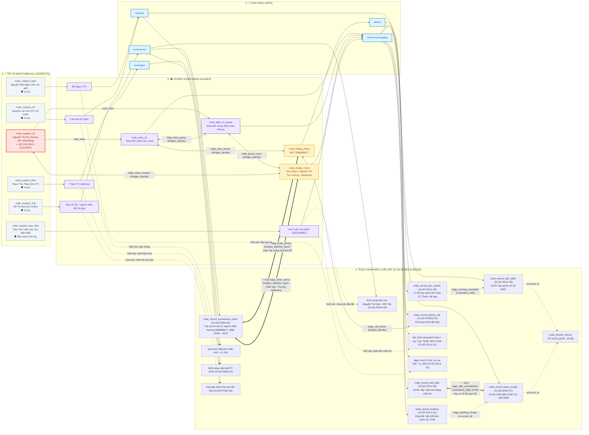

# Storyboard & Sơ đồ Pháp y - Màn 1: Điện thoại ngoài phòng tắm

> **Thẩm quyền Tác giả**: Được thiết kế bởi `level-designer`. Tái sử dụng hồ sơ gốc tại [husband-profile.md](husband-profile.md). Tài liệu này định nghĩa nhân khẩu học của các nghi phạm, kịch bản tương tác theo dòng thời gian (Storyboard), sơ đồ Timeline và sơ đồ mạng lưới nối kết Manh mối - Nghi phạm trước khi viết dữ liệu thoại chi tiết ([level-01-phone-data.md](level-01-phone-data.md)).

---

## 0. Ý tưởng Màn chơi (Design Pitch)

- **Cú lừa meme**: Người chơi Việt Nam quen meme "lưu số bồ là Anh Tuấn Thợ Điện". Ở màn này, "Anh Tuấn Thợ Điện" là **thợ điện thật** ở quê. Tiểu tam trốn sau một danh bạ đồng nghiệp nam rất nhạt: **"Khoa BE"**. Màn chơi dạy vòng lặp cốt lõi: không bắt ghen theo cảm tính TikTok, phải nối bằng chứng.
- **Mở màn**: 23:45 thứ Năm 15/10/2026. Thịnh đang tắm. Lần đầu sau 3 năm cưới, anh để điện thoại ngoài phòng vì máy còn 8% pin phải cắm sạc. Màn hình khóa có hai thông báo.
- **Bí mật của vợ**: Chiều nay Thư đi khám và biết mình có thai 6 tuần. Cô định tối nay nói với chồng. Lời khai "họp sprint" của Thịnh vì vậy càng cay đắng. Bí mật chỉ được nói ra ở bước kết thúc đối chất.
- **Móc nối Màn 2**: Sau phán quyết, ngân hàng báo nhận `+1.000 đ` từ `NGUYEN THI THU HUONG` kèm lời nhắn. Hương đổi kênh liên lạc sang lời nhắn chuyển khoản, khớp lộ trình tiến hóa ở [husband-profile.md](husband-profile.md#4-lộ-trình-tiến-hóa-chiêu-trò-qua-các-màn-cross-level-escalation-arc).

---

## 1. Hồ sơ Nhân khẩu học Nghi phạm & Nhân vật Trong Màn (Suspect & Cast Personas)

*Kế thừa chân dung chồng Thịnh (31 tuổi), vợ Thư (28 tuổi) và dàn nhân vật cố định từ [husband-profile.md](husband-profile.md). Mọi hội thoại tiếng Việt bắt buộc tuân thủ chuẩn xưng hô tiếng Việt tự nhiên (`anh/em/chị/cô/chú/bác/con/mày/tao`) theo đúng độ tuổi, giới tính, thứ bậc và mối quan hệ thực tế với người chồng (chồng 29 tuổi):*

| ID Nhân vật / Nghi phạm | Họ tên Thật | Tuổi & Giới tính | Nghề nghiệp & Nhân khẩu học | Quan hệ với Chồng & Cách xưng hô chuẩn | Vỏ bọc trong máy (`alias`) | Khẩu khí & Thói quen ngôn ngữ (`chatTone`) | Vai trò trong Màn |
|---|---|---|---|---|---|---|---|
| `suspect_01` | Nguyễn Thị Thu Hương | 25 tuổi, Nữ | Marketing Executive Technosoft, vào công ty 08/09/2026 | Nhỏ hơn Thịnh 6 tuổi; `anh` - `em`. Cách xưng này cũng tự nhiên với một đồng nghiệp nam trẻ, nên vỏ bọc đứng vững | "Khoa BE" (`contact_011`, SĐT `0988886677`) | Nhắn như đồng nghiệp trẻ: viết tắt nhẹ (`a/e`, `rùi`, `nha`), thỉnh thoảng dùng emoji 🥹 😔. Lỡ lời qua việc Marketing (banner, CTA) dù tên là dev backend | **Kẻ chủ mưu (Culprit)** |
| `suspect_02` | Trần Văn Tuấn | 41 tuổi, Nam | Thợ điện nước ở quê Thịnh, hàng xóm của mẹ | Lớn hơn Thịnh 12 tuổi; Thịnh xưng `em` gọi `anh`, Tuấn xưng `anh` gọi `em`. Gọi mẹ Thịnh là "bà ấy" theo lối nói làng quê | "Anh Tuấn Thợ Điện" (`contact_013`, SĐT `0912345801`) | Ngắn gọn, chất phác, viết đủ chữ, ít emoji | Bẫy meme (Vô tội) |
| `suspect_03` | Nguyễn Bảo Ngọc | 20 tuổi, Nữ | Sinh viên năm 2, em gái ruột Thịnh, ở KTX An Hòa | Nhỏ hơn 9 tuổi; `anh` - `em` | "Bé Ngọc KTX" (`contact_003`, SĐT `0922334455`) | Gen Z, teencode dày (`rùi`, `nha`, `lun`, `đỉnh chóp`, 😭 🙊) | Bẫy nghi ngờ (Vô tội) |
| `suspect_04` | Nguyễn Lan Anh | 27 tuổi, Nữ | Kế toán nội bộ kiêm thủ quỹ công đoàn Technosoft | Nhỏ hơn 2 tuổi; `a` - `e` | "Lan Anh Kế Toán" (`contact_007`, SĐT `0966778899`) | Lịch sự công sở, hay giục đóng quỹ, dùng 😤 khi trêu | Bẫy nghi ngờ (Vô tội) |
| `suspect_05` | Phạm Thu Thảo | 24 tuổi, Nữ | Huấn luyện viên cá nhân California Fitness (tầng 5 tòa Minh An) | Nhỏ hơn 5 tuổi; `a` - `e` | "Thảo PT California" (`contact_005`, SĐT `0944556677`) | Năng động, chuyên môn, nhắc đau cột sống, hơi gắt khi khách bỏ buổi | Bẫy nghi ngờ (Vô tội) |
| `suspect_06` | Đỗ Thị Mai | 24 tuổi, Nữ | Lễ tân sảnh tòa nhà Minh An | Nhỏ hơn 5 tuổi; `a` - `e` | "Mai Lễ Tân" (`contact_009`, SĐT `0988990011`) | Lịch sự dịch vụ, `ạ` cuối câu, 🙏 | Bẫy nghi ngờ (Vô tội) |
| `contact_wife` | Trần Minh Thư | 28 tuổi, Nữ | Vợ hợp pháp, kế toán | Nhỏ hơn 1 tuổi; `anh` - `em` | "Vợ" (`contact_010`, SĐT `0900112233`) | Quan tâm, nhẹ nhàng; ngày D có chuyện vui muốn nói | Nhân vật mỏ neo (người chơi) |
| `contact_mom` | Nguyễn Thị Hòa | 56 tuổi, Nữ | Mẹ ruột Thịnh ở quê, sinh nhật 18/10 | Bề trên; Thịnh xưng `con` gọi `mẹ` | "Mẹ Ở Quê" (`contact_001`, SĐT `0915220011`) | Chính tả chuẩn, không viết tắt, hay dặn "đừng mua gì tốn kém" | Sinh hoạt / Giải oan thợ điện |
| `contact_dev` | Nam Dev và Bách Chut | 30 và 27 tuổi, Nam | Đồng nghiệp Team Dev Technosoft | Nam ngang hàng (`ông - tôi`); Bách nhỏ hơn (`a - e`) | "Team Dev Technosoft" (nhóm), "Nam Dev" (`contact_004`) | Tiếng lóng dev, viết tắt, `ae` | Sinh hoạt công việc / Phá ngoại phạm |
| `contact_hr` | Phòng Nhân sự Technosoft | - | Tài khoản HR trong nhóm toàn công ty | Lịch sự hành chính | "HR Technosoft" trong nhóm "Technosoft - Toàn công ty" | Văn phong thông báo | Nguồn tên pháp lý của Hương |
| `contact_friend` | Tuấn Chó (Nguyễn Tuấn) | 29 tuổi (1997), Nam | Bạn thân | Kém Thịnh 2 tuổi nhưng thân, vẫn xưng `tôi - ông` | "Tuấn Chó" (`contact_006`) | Suồng sã, bóng đá | Sinh hoạt bạn bè |

> **Cơ chế lộ tên trong nhóm (đúng hành vi app nhắn tin thật)**: Trong nhóm "Technosoft - Toàn công ty", tin của Hương hiển thị theo tên Thịnh đã lưu là **"Khoa BE"**. Tin ghim của HR ghi tên thật `Nguyễn Thị Thu Hương - Marketing Executive`, và HR trả lời "Khoa BE" bằng câu *"Cảm ơn Hương nha"*. Người chơi tinh ý sẽ thấy một "dev backend" đăng việc Marketing và được gọi là Hương.

> **Cơ chế Lột trần Vỏ bọc (Disguise Unmasking UX)**: Trong bộ chọn nghi phạm ([US-016](../../output/epic-03-wife-notebook-verdict-social-sharing/us-016-anytime-confrontation-hub-dynamic-excuse-engine.md)), `suspect_01` ban đầu hiển thị là `"Khoa BE"`. Khi người chơi nối số `0988886677` của danh bạ "Khoa BE" với số người nhận đơn váy, thẻ chuyển sang `"Nguyễn Thị Thu Hương"`, nhãn `🎭 Vỏ bọc: "Khoa BE"`, manh mối `📞 Trùng SĐT: 0988886677` và dấu `"ĐÃ LỘT MẶT NẠ"`. Bộ chọn không được hiện tên thật hoặc chữ "Marketing" trước bước này.

---

## 2. Kịch bản Tương tác Theo Dòng thời gian (Chronological Interaction Storyboard)

*D-Day = thứ Năm 15/10/2026, kiểm tra máy lúc 23:45. Không có bản ghi sau 23:45 D. `EVT-*` là chuỗi vụ án, `ACT-*` là sinh hoạt / giải oan.*

| Thứ tự / ID | Thời điểm | Chồng tương tác với ai | Họ làm gì cùng nhau / cho nhau | Địa điểm & Vật phẩm trao tay (Ai giữ trước -> sau) | Qua Ứng dụng nào (`appId`) | Mã Bản ghi / Manh mối sinh ra (`Record ID` / `Clue ID`) | Sự thật ngầm vs Vỏ bọc hiển thị |
|---|---|---|---|---|---|---|---|
| `ACT-00` | 08/09 09:00 (tin ghim) | HR Technosoft | Chào mừng nhân sự mới trong nhóm toàn công ty | - | `internet-messaging` | `thread_012` / `msg_012_0001` (`CLUE-ZOLA-08`) | Tên thật và chức danh của Hương, ghim từ trước |
| `ACT-01` | 10/10 08:30 - 08:45 | Công ty, Vợ | Nhận lương 35tr, nộp vợ 31,5tr | Ngân hàng | `banking` | `tx_020`, `tx_019` (Sinh hoạt) | Mỏ neo tài chính gia đình |
| `EVT-01` | 12/10 09:40 | Hương ("Khoa BE") | Nhờ Thịnh xem banner, phần CTA | Văn phòng | `internet-messaging` | `thread_003` (Sinh hoạt khả nghi nhẹ) | Việc Marketing thật; lỡ lộ "dev backend" làm banner |
| `EVT-02` | 12/10 20:10 - 20:15 | Shop Lụa Satin | Đặt set váy lụa be **size S**, người nhận `Nguyễn Thị Thu Hương`, SĐT `0988886677`, giao sảnh Technosoft; dặn thiệp "15/09 - 15/10 ♡" | Shop -> sảnh Minh An | `ecommerce` | `order_005`, `shopchat_004` (`CLUE-POSH-05`) | Quà kỷ niệm 1 tháng (bắt đầu 15/09). Để tên Hương làm người nhận nhằm có sẵn cớ "đặt hộ" |
| `ACT-02` | 13/10 07:15 - 07:30 | Mẹ | Mẹ kể bình nóng lạnh hỏng, đun nước tắm; Thịnh "để con tính" | Nhà mẹ ở quê | `internet-messaging` | `thread_010` (Giải oan thợ điện) | Động cơ thật của chuyện thợ điện |
| `ACT-03` | 13/10 08:10 - 08:30 | Anh Tuấn Thợ Điện | Thịnh nhờ lắp bình nóng lạnh nhà mẹ trước chủ nhật, làm bất ngờ dịp sinh nhật mẹ | Nhà mẹ | `internet-messaging` | `thread_004` (Giải oan thợ điện) | Thợ điện thật |
| `ACT-04` | 13/10 09:30 | Shop điện máy | Đặt bình nóng lạnh 20L, người nhận `Nguyễn Thị Hòa`, SĐT `0915220011`, giao nhà mẹ | Shop -> nhà mẹ | `ecommerce` | `order_004` (`CLUE-POSH-06`) | Người nhận nữ lạ nhưng SĐT trùng danh bạ "Mẹ Ở Quê" |
| `ACT-05` | 13/10 17:15 - 17:22 | Thảo PT | Chốt buổi đánh giá cột sống thứ Năm 18:00, trước giờ họp sprint 19:00 | Phòng gym tầng 5 Minh An | `internet-messaging` | `thread_009` (Giải oan Thảo) | Lịch tập trị liệu có trước cuộc hẹn |
| `ACT-06` | 13/10 21:00 - 21:05 | Vợ | Vợ xin chồng về sớm đi khám thứ Năm; Thịnh: "Thứ 5 anh có họp sprint rồi vợ ơi" | - | `internet-messaging` | `thread_005` (Sinh hoạt / cài cảm xúc) | Lúc này họp sprint là thật |
| `ACT-07` | 14/10 15:02 - 15:10 | Lan Anh | Lan Anh nhờ Thịnh đặt hoa sáp sinh nhật anh Tuấn Anh, để tên Mai lễ tân nhận cho kín vì anh Tuấn Anh hay xuống sảnh | - | `internet-messaging` | `thread_007` (Giải oan Mai) | Quà chung của Team Dev |
| `ACT-08` | 14/10 15:20 | Shop Hoa Sáp | Đặt lẵng hoa sáp, người nhận `Đỗ Thị Mai`, SĐT `0988990011`, thiệp "Chúc mừng sinh nhật! - Team Dev" | Shop -> sảnh Minh An | `ecommerce` | `order_003`, `shopchat_002` (`CLUE-POSH-06`) | Người nhận nữ là lễ tân nhận hộ |
| `EVT-03` | 14/10 21:12 - 21:16 | Hương ("Khoa BE") | "Thứ 5 tròn 1 tháng rồi đó a. A nhớ vụ khao nhé"; Thịnh: "Tối đó a vướng họp sprint rồi e." | - | `internet-messaging` | `thread_003` | Kỷ niệm 1 tháng quen nhau (15/09), không phải 1 tháng vào công ty (08/09) |
| `EVT-04` | D 11:35 - 11:42 | Mai Lễ Tân | Mai báo 2 kiện: 1 túi dài người nhận Mai (hoa), 1 hộp nhỏ người nhận khác nhưng shipper dặn đưa Thịnh. Thịnh: "Của a cả, chiều a xuống lấy" | Sảnh Minh An: hộp váy (shipper -> Mai -> Thịnh) | `internet-messaging` | `thread_011` (Giải oan Mai + gợi ý phụ) | Thịnh chặn gói quà mang tên người khác |
| `ACT-09` | D 15:05 | Mai Lễ Tân | Thịnh lấy hộp nhỏ; túi hoa Mai cất kho tới thứ Hai như chị Lan Anh dặn | Sảnh | `internet-messaging` | `thread_011` (Giải oan Mai) | Hoa ở lại sảnh, váy đi theo Thịnh |
| `ACT-10` | D 15:30 - 15:35 | Anh Tuấn Thợ Điện | Thịnh chuyển cọc 1.500.000đ; Tuấn: "Anh nhận cọc rồi nhé" | Ngân hàng | `banking` + `internet-messaging` | `tx_006`, `thread_004` (Giải oan thợ điện) | Nội dung chuyển khoản chỉ ghi "Coc" |
| `ACT-11` | D 16:05 - 16:21 | Vợ | "Em khám xong rồi. Tối về em có chuyện muốn nói 🙂" | Bệnh viện | `internet-messaging` | `thread_005` (Cài cảm xúc) | Thư biết mình có thai 6 tuần |
| `EVT-05` | D 17:30 - 17:33 | Team Dev | Nam: "Sếp Tuấn Anh 6h bay Đà Nẵng, họp sprint tối nay dời sang T2 nhé ae"; Thịnh: "Ok ông 👍" | - | `internet-messaging` | `thread_002` / `msg_002_0012` (`CLUE-ZOLA-09`) | Thịnh biết không còn cuộc họp nào |
| `EVT-06` | D 17:35 - 17:40 | Hương ("Khoa BE") | Thịnh: "Tối nay a xong sớm. Vụ khao làm luôn nhé?"; Khoa: "Ok a, e đặt chỗ hôm trước lúc 7h30 nha." | Quán Cơm Niêu Phố Cổ (không nêu tên trong chat) | `internet-messaging` | `thread_003` / `msg_003_0014` (`CLUE-ZOLA-01`) | Cuộc họp bị hủy biến thành buổi hẹn |
| `ACT-12` | D 18:00 | Thịnh rời văn phòng | Lan Anh sau đó nhắn thấy Thịnh về từ 6h | Sảnh Minh An | - | (Không có bản ghi trực tiếp) | Không có app nào ghi vị trí 18:00 - 19:20 (khoảng trống có chủ đích) |
| `ACT-13` | D 18:20 - 18:45 | Thảo PT | "A tới chưa? E đợi a nãy giờ 😤"; "A ko tới thì e trừ buổi nha a" | Gym tầng 5 | `internet-messaging` | `thread_009` (Bẫy nghi ngờ trong giờ tối) | Thịnh quên lịch tập |
| `EVT-07` | D 18:52 - 18:56 | Vợ | Vợ: canh cua mồng tơi, mấy giờ về; Thịnh: "Tối nay họp sprint với cả team, chắc 9h. Vợ ăn trước nhé ❤️" | - | `internet-messaging` | `thread_005` / `msg_005_0079` (`CLUE-ZOLA-09`) | Lời khai giả lần 1 (sau khi họp đã hủy) |
| `ACT-14` | D 19:05 | California Fitness | SMS báo vắng mặt buổi PT 18:00, buổi đã bị trừ | - | `messages` | `sms_gym_absent` (`CLUE-MSG-02`) | Giải oan Thảo; Thịnh không ở gym |
| `EVT-08` | D 19:18 - 19:20 | Hương ("Khoa BE") | Thịnh gọi 26 giây | Cơm Niêu Phố Cổ, tầng 2 | `phone` | `call_003` | Gặp nhau, trao hộp váy |
| `ACT-15` | D 19:50 - 20:13 | Bé Ngọc | Ngọc xin 1,2tr học lại môn Vĩ mô; Thịnh chuyển 20:10; tin cuối "Nhớ là a đừng kể gì nha 🙊" | Ngân hàng | `internet-messaging` + `banking` | `thread_008`, `tx_005` (`CLUE-ZOLA-10`) | Bản xem trước bị cắt trông như che giấu; đọc trọn luồng thấy "mẹ mà biết thì e toi" |
| `ACT-16` | D 19:58 - 20:31 | Lan Anh | "6h thấy a về sớm thế, mỗi a chưa đóng quỹ sinh nhật anh Tuấn Anh 😤"; Thịnh chuyển 500k lúc 20:30: "A ứng luôn cho cả nhóm" | Ngân hàng | `internet-messaging` + `banking` | `thread_007`, `tx_004` (Giải oan Lan Anh + phá ngoại phạm phụ) | Chuyển tiền cho phụ nữ giữa buổi tối, nhưng là quỹ chung |
| `EVT-09` | D 20:45 - 20:46 | Vợ | Vợ: "Họp xong chưa anh?"; Thịnh: "Chưa em, sếp Tuấn Anh đang chốt nốt." | - | `internet-messaging` | `thread_005` / `msg_005_0082` (`CLUE-ZOLA-09`) | Lời khai giả lần 2; sếp Tuấn Anh đã bay Đà Nẵng |
| `EVT-10` | D 20:48 | Cơm Niêu Phố Cổ | Quẹt thẻ 640.000đ | Quán | `banking` | `tx_003` (`CLUE-BANK-07`) | Smoking Gun ngoại phạm: 2 phút sau lời khai họp |
| `EVT-11` | D 21:31 - 21:33 | Hương ("Khoa BE") | Thịnh: "Mai a xem lại banner cho e nhé."; Khoa: "Vâng ạ, e gửi file từ sáng." | - | `internet-messaging` | `thread_003` | Kết luồng bằng chuyện công việc, giữ vỏ bọc đồng nghiệp |
| `EVT-12` | D 22:10 | Vợ | Thịnh: "Anh về tới hầm rồi." | Hầm xe CT2 An Bình | `internet-messaging` | `thread_005` | Về nhà bằng xe máy |
| `ACT-17` | D 22:58 | Anh Tuấn Thợ Điện | "Sáng mai anh vào lắp sớm. Em yên tâm, không để bà ấy biết đâu." | - | `internet-messaging` | `thread_004`, `toast_001` (`CLUE-ZOLA-11`) | Mồi meme: "bà ấy" nghe như "bà xã", thực ra là mẹ Thịnh |
| `EVT-13` | D 23:20 | Hương ("Khoa BE") | Thịnh gọi 96 giây từ ban công | - | `phone` | `call_001` (`CLUE-PHONE-01`) | Hỏi Hương đã về tới nhà chưa |
| `EVT-14` | D 22:31 - 23:42 | Hội Poker, Cầu lông, Minh Bằng Cổ | Bạn bè chat khuya; sếp Tuấn Anh báo "đang ở Đà Nẵng"; A9 đòi nợ phỉnh (`toast_002`) | - | `internet-messaging` | `thread_046`, `thread_047`, `thread_048` | Đẩy "Khoa BE" xuống giữa hộp thư; xác nhận gián tiếp họp bị hủy |
| `ACT-18` | D 23:45 | Thư | Thịnh vào tắm, máy 8% pin cắm sạc ngoài phòng; Thư cầm máy | Phòng ngủ 1206 CT2 | - | `deviceMetadata` | Thời điểm kiểm tra máy |

---

## 3. Sơ đồ Dòng thời gian Cốt truyện & Dấu vết Ứng dụng (Mermaid Story Timeline Diagram)

```mermaid
flowchart TD
  subgraph DAY_MINUS ["1. Trước D-Day (08/09 - 14/10): Chuẩn bị & sinh hoạt"]
    T0["08/09 - ACT-00<br/>HR ghim: chào mừng Nguyễn Thị Thu Hương - Marketing<br/>📱 internet-messaging (thread_012)"]
    T1["12/10 20:15 - EVT-02<br/>Đặt váy lụa be size S, người nhận Hương 0988886677, thiệp 15/09 - 15/10<br/>📱 ecommerce (order_005, shopchat_004)"]
    T2["13/10 - ACT-02..04<br/>Mẹ hỏng bình nóng lạnh; nhờ Anh Tuấn Thợ Điện; đặt bình 20L cho Nguyễn Thị Hòa<br/>📱 internet-messaging + ecommerce (order_004)"]
    T3["13/10 - ACT-05, ACT-06<br/>Thảo chốt PT 18:00 thứ Năm; vợ xin đi khám, Thịnh bảo vướng họp<br/>📱 internet-messaging"]
    T4["14/10 - ACT-07, ACT-08, EVT-03<br/>Hoa sáp sinh nhật sếp gửi tên Mai; Khoa BE: Thứ 5 tròn 1 tháng<br/>📱 internet-messaging + ecommerce (order_003)"]
  end

  subgraph D_DAY_DAYTIME ["2. Ban ngày D-Day 15/10"]
    T5["11:35 - 15:05 - EVT-04, ACT-09<br/>Mai báo 2 kiện; Thịnh lấy hộp váy, hoa ở lại kho<br/>📱 internet-messaging (thread_011)"]
    T6["15:30 - ACT-10<br/>Cọc 1,5tr cho TRAN VAN TUAN<br/>📱 banking (tx_006)"]
    T7["16:05 - ACT-11<br/>Vợ: Tối về em có chuyện muốn nói<br/>📱 internet-messaging (thread_005)"]
    T8["17:30 - EVT-05<br/>Team Dev: họp sprint dời sang T2, Thịnh: Ok ông<br/>📱 internet-messaging (thread_002)"]
    T9["17:35 - 17:40 - EVT-06<br/>Thịnh: xong sớm, khao luôn nhé? Khoa: đặt chỗ hôm trước 7h30<br/>📱 internet-messaging (thread_003)"]
  end

  subgraph D_DAY_NIGHT ["3. Tối D-Day: ngoại phạm giả & các bẫy nghi ngờ"]
    T10["18:20 - 19:05 - ACT-13, ACT-14<br/>Thảo đợi ở gym; SMS báo vắng mặt<br/>📱 internet-messaging + messages"]
    T11["18:55 - EVT-07<br/>Báo vợ: họp sprint với cả team<br/>📱 internet-messaging (thread_005)"]
    T12["19:18 - 19:20 - EVT-08<br/>Gọi Khoa BE 26s<br/>📱 phone"]
    T13["20:10 - 20:31 - ACT-15, ACT-16<br/>Chuyển Ngọc 1,2tr; chuyển Lan Anh 500k<br/>📱 banking + internet-messaging"]
    T14["20:46 - EVT-09<br/>Báo vợ: sếp Tuấn Anh đang chốt nốt<br/>📱 internet-messaging (thread_005)"]
    T15["20:48 - EVT-10<br/>Quẹt thẻ 640.000đ COM NIEU PHO CO<br/>📱 banking (tx_003)"]
    T16["21:31 - EVT-11<br/>Khoa BE: chuyện banner công việc<br/>📱 internet-messaging"]
    T17["22:58 - ACT-17 (toast_001)<br/>Anh Tuấn Thợ Điện: không để bà ấy biết đâu<br/>📱 internet-messaging"]
    T18["23:20 - EVT-13<br/>Gọi Khoa BE 96s<br/>📱 phone (call_001)"]
    T19["22:31 - 23:42 - EVT-14 (toast_002)<br/>Nhóm Poker, Cầu lông chat khuya<br/>📱 internet-messaging"]
  end

  T0 --> T1 --> T2 --> T3 --> T4 --> T5 --> T6 --> T7 --> T8 --> T9 --> T10 --> T11 --> T12 --> T13 --> T14 --> T15 --> T16 --> T17 --> T18 --> T19
```

---

## 4. Sơ đồ Mạng lưới Nghi phạm -> Vỏ bọc -> Ứng dụng -> Nút Manh mối (Mermaid Clue & Suspect Graph)

*Bố cục 4 cột từ Trái sang Phải (`ALL_SUSPECTS -> ALIASES -> APPS -> CLUE_NODES`), khớp bảng Nodes & Edges tại [level-01.md](level-01.md#52-bảng-dữ-liệu-nodes--edges-compiler--tooling-ssot).*

