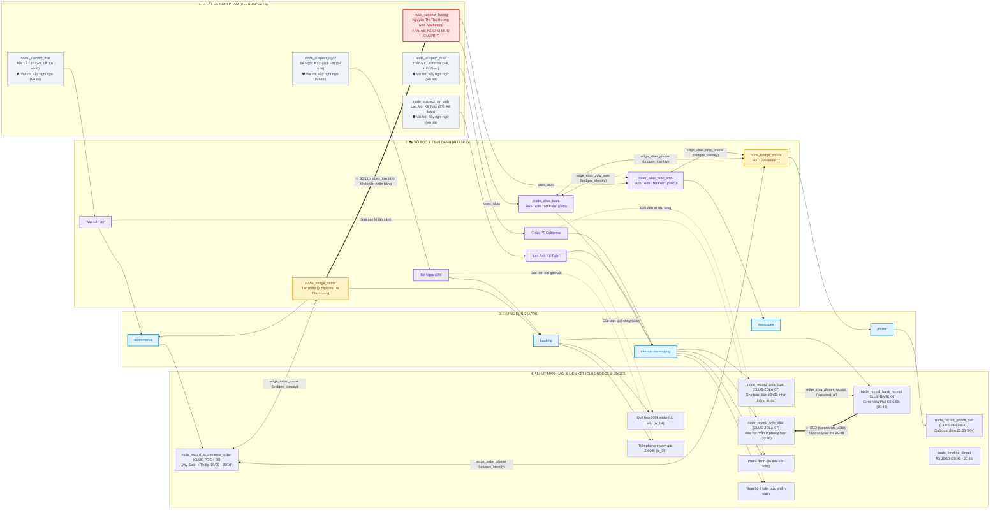

# Storyboard & Sơ đồ Pháp y - Màn 1: Cơn ghen lúc nửa đêm

> **Thẩm quyền Tác giả**: Được thiết kế bởi `level-designer`. Tái sử dụng hồ sơ gốc tại [husband-profile.md](husband-profile.md). Tài liệu này định nghĩa nhân khẩu học của các nghi phạm, kịch bản tương tác theo dòng thời gian (Storyboard), sơ đồ Timeline và sơ đồ mạng lưới nối kết Manh mối - Nghi phạm trước khi viết dữ liệu thoại chi tiết.

---

## 1. Hồ sơ Nhân khẩu học Nghi phạm & Nhân vật Trong Màn (Suspect & Cast Personas)

*Kế thừa chân dung chồng Hoàng (29 tuổi, Senior Full-stack Dev), vợ Thư (28 tuổi) và dàn nhân vật cố định từ [husband-profile.md](husband-profile.md). Mọi hội thoại tiếng Việt bắt buộc tuân thủ chuẩn xưng hô tiếng Việt tự nhiên (`anh/em/chị/cô/chú/con/mày/tao`) theo đúng độ tuổi, giới tính và vai vế nhân khẩu học:*

| ID Nhân vật / Nghi phạm | Họ tên Thật | Tuổi & Giới tính | Nghề nghiệp & Nhân khẩu học | Quan hệ với Chồng & Cách xưng hô chuẩn | Vỏ bọc trong máy (`alias`) | Khẩu khí & Thói quen ngôn ngữ (`chatTone`) | Vai trò trong Màn |
|---|---|---|---|---|---|---|---|
| `suspect_huong` | Nguyễn Thị Thu Hương | 25 tuổi, Nữ | Chuyên viên Marketing Technosoft (28 Duy Tân, Cầu Giấy, Hà Nội) | Nhỏ hơn Hoàng 4 tuổi; xưng hô chuẩn: `anh` - `em` | "Anh Tuấn Thợ Điện" (Zola `thread_tuan`, SĐT `0988886677`, SMS `contact_10`) | Mập mờ, nũng nịu, dùng ẩn ý kỹ thuật điện ("bảo hành đường dây", "đo tải", "cơm niêu"); nhắn tin viết tắt nhẹ (`a/e`, `rùi`, `vs`) | **Kẻ chủ mưu (Culprit)** |
| `suspect_lan_anh` | Lan Anh Kế Toán | 27 tuổi, Nữ | Thủ quỹ công đoàn kiêm Kế toán nội bộ Technosoft | Nhỏ hơn Hoàng 2 tuổi; xưng hô chuẩn: `a` - `e` | "Lan Anh Kế Toán" (Zola `thread_lan_anh`, SĐT `0966778899`) | Lịch sự công sở, chuẩn mực thu chi, giục nộp quỹ sinh nhật sếp Hùng 500k | Bẫy nghi ngờ 1 (Vô tội) |
| `suspect_thao` | Thảo PT Gym | 24 tuổi, Nữ | Nữ huấn luyện viên thể hình California Fitness | Nhỏ hơn Hoàng 5 tuổi; xưng hô chuẩn: `a` - `e` | "Thảo PT California" (Zola `thread_thao`, SĐT `0944556677`) | Năng động, chuyên nghiệp, nhắc mang phiếu đánh giá đau cột sống và tập nhẹ | Bẫy nghi ngờ 2 (Vô tội) |
| `suspect_ngoc` | Bé Ngọc Sinh Viên | 20 tuổi, Nữ | Em gái ruột của Hoàng ở quê lên trọ học đại học tại Cầu Giấy | Nhỏ hơn Hoàng 9 tuổi; xưng hô chuẩn: `anh` - `em` (gọi "anh trai iu quý") | "Bé Ngọc KTX" (Zola `thread_ngoc`, SĐT `0922334455`, Bank `tx_05`) | Đậm chất sinh viên Gen Z, teencode nhiều (`rùi`, `nha`, `lun`, `đỉnh chóp`); cảm ơn tiền trọ và đèn học | Bẫy nghi ngờ 3 (Vô tội) |
| `suspect_mai` | Mai Lễ Tân | 24 tuổi, Nữ | Nhân viên lễ tân sảnh tòa nhà Minh An (Technosoft) | Nhỏ hơn Hoàng 5 tuổi; xưng hô chuẩn: `a` - `e` | "Mai Lễ Tân" (Zola `thread_mai`, SĐT `0988990011`) | Lịch sự, chu đáo công việc, báo nhận hộ 2 kiện bưu phẩm (hộp quà + túi dài hoa sáp) | Bẫy nghi ngờ 4 (Vô tội) |
| `contact_wife` | Vợ (Trần Minh Thư) | 28 tuổi, Nữ | Vợ hợp pháp của Hoàng | Nhỏ hơn chồng 1 tuổi; xưng hô chuẩn: `anh` - `em` | "Vợ" (Zola `thread_wife`, Phone `contact_9`) | Quan tâm gia đình, dặn về ăn cơm, để phần canh nóng trong nồi | Nhân vật mỏ neo |
| `contact_mom` | Mẹ Ở Quê | 56 tuổi, Nữ | Mẹ ruột của Hoàng ở quê | Bề trên; Hoàng xưng `con` gọi `mẹ` | "Mẹ Ở Quê" (Zola `thread_family`, Phone `contact_0`) | Mẫu mực, chu đáo, chính tả chuẩn không viết tắt, gửi gà và bưởi ở quê lên | Sinh hoạt gia đình |
| `contact_friend` | Tuấn Đụt | 29 tuổi, Nam | Bạn thân chí cốt cùng tuổi của Hoàng | Ngang hàng; xưng hô `tôi - ông` | "Tuấn Đụt" (Zola `thread_friend`, Phone `contact_5`) | Suồng sã, đam mê bóng đá phủi, nhắc mang áo thi đấu sân cỏ nhân tạo | Sinh hoạt bạn bè |
| `contact_dev` | Nam Dev | 30 tuổi, Nam | Đồng nghiệp / Tech Lead bạn cùng nhóm Technosoft | Ngang hàng / đồng nghiệp; xưng hô `ông - tôi` / `anh - em` | "Nam Dev" (Zola `thread_dev`, Phone `contact_3`) | Tiếng lóng dev (*"staging"*, *"bug cart"*, *"deploy"*, *"quantity"*), phối hợp công việc | Sinh hoạt công việc |

---

## 2. Kịch bản Tương tác Theo Dòng thời gian (Chronological Interaction Storyboard)

*Liệt kê theo trình tự thời gian từ quá khứ gần đến thời điểm kiểm tra máy (`D-Day` = 15/10/2026, 23:45). Bao gồm chuỗi sự kiện vụ án (`EVT-*`) và hoạt động sinh hoạt/giải oan đời thường (`ACT-*`):*

| Thứ tự / ID | Thời điểm | Chồng tương tác với ai | Họ làm gì cùng nhau / cho nhau (ăn uống, mua sắm, công việc, chuyển tiền, chat...) | Địa điểm & Vật phẩm trao tay (Ai giữ trước -> sau) | Qua Ứng dụng nào (`appId`) | Mã Bản ghi / Manh mối sinh ra (`Record ID` / `Clue ID`) | Sự thật ngầm vs Vỏ bọc hiển thị |
|---|---|---|---|---|---|---|---|
| `ACT-01` | 10/10 08:30 | Hoàng nhận lương | Công ty Technosoft trả lương tháng 10: 35.000.000đ | Tài khoản Techcombank | `banking` | `tx_07` (Sinh hoạt) | Lương chính ngạch |
| `ACT-02` | 10/10 08:45 | Chồng nộp lương cho Vợ | Chuyển 90% lương (31.500.000đ) vào tài khoản vợ cho sinh hoạt gia đình | Techcombank -> Vợ | `banking` | `tx_home` (Mỏ neo) | Vợ quản lý tài chính gia đình |
| `ACT-03` | 10/10 09:10 | Chồng thanh toán Internet | Thanh toán cước VNPT tháng 10: 280.000đ | Techcombank | `banking` | `tx_net` (Sinh hoạt) | Chi tiêu sinh hoạt gia đình |
| `ACT-04` | 12/10 08:50 | Chồng hỗ trợ em gái | Chuyển 2.500.000đ tiền phòng trọ cho em gái Bảo Ngọc | Techcombank -> Ngọc | `banking` | `tx_05` (Giải oan Ngọc) | Anh trai hỗ trợ em gái học ĐH |
| `ACT-05` | 12/10 09:10 | Em gái Ngọc cảm ơn anh | Ngọc nhắn đã nhận tiền phòng trọ, mẹ dặn chủ nhật về mang áo khoác | Zola | `internet-messaging` | `thread_ngoc` (Giải oan Ngọc) | Tin nhắn gia đình trong sáng |
| `EVT-01` | 12/10 20:15 | Chồng đặt quà tặng bồ nhí | Chat shop `seller_satin` đặt Set váy lụa công sở (be, size S) trị giá 489.000đ, kèm lời dặn ghi thiệp riêng: "15/09 - 15/10. Vẫn chỗ cũ nhé. H." | Shopee giao đến sảnh Technosoft | `ecommerce` | `order_01`, chat `seller_satin` (`CLUE-POSH-05`) | Mua quà kỷ niệm 1 tháng vụng trộm; ngụy trang giao sảnh công ty cho Hương |
| `EVT-02` | 13/10 10:14 | Hương hẹn lịch ăn tối | Hương nhắn hẹn tối thứ Năm (15/10) ghé và nhắc khao thợ điện bữa cơm niêu | Zola alias thợ điện | `internet-messaging` | `thread_tuan` | Mượn cớ bảo hành sửa điện để hẹn hò ăn tối |
| `ACT-06` | 13/10 17:22 | Thảo PT xếp lịch tập | Thảo đổi giờ tập gym, nhắc mang phiếu đánh giá cột sống | Zola | `internet-messaging` | `thread_thao` (Giải oan Thảo) | Khách hàng tập trị liệu đau lưng |
| `ACT-07` | 14/10 07:20 | Mẹ gửi gà ở quê lên | Mẹ dặn cất gà vào ngăn đá; Hoàng nhắn nhận rồi, chủ nhật hai vợ chồng về | Zola | `internet-messaging` | `thread_family` (Sinh hoạt) | Sinh hoạt gia đình hiếu thảo |
| `EVT-03` | 14/10 12:40 | Hương hoàn tiền vật tư | Hương chuyển hoàn 160.000đ tiền thừa mua đồ điện qua tài khoản | Techcombank | `banking` | `tx_02` (`CLUE-BANK-06`) | Tên người chuyển: `Nguyen Thi Thu Huong` (khớp SĐT nhận váy) |
| `ACT-08` | 14/10 15:06 | Lan Anh thu quỹ sinh nhật sếp | Lan Anh nhắn thu tiền sinh nhật sếp Hùng; Hoàng chuyển khoản 500k cho cả nhóm (mỗi người 100k) | Zola + Bank | `internet-messaging` + `banking` | `thread_lan_anh`, `tx_04` (Giải oan Lan Anh) | Quỹ công đoàn phòng IT, hoàn toàn trong sáng |
| `ACT-09` | 14/10 17:40 | Vợ nhờ mua túi rác | Vợ dặn mua túi rác loại vừa; Hoàng mua để cạnh cửa | Zola + Shopee | `internet-messaging` + `ecommerce` | `thread_wife`, `order_bag` (Sinh hoạt) | Sinh hoạt đời thường vợ chồng |
| `EVT-04` | D-Day 11:35 | Giao kiện hàng quà tặng | Kiện hàng `order_01` (váy lụa, người nhận: Nguyễn Thị Thu Hương, SĐT: `0988886677`) và lẵng hoa sáp (`order_03`) giao đến sảnh Technosoft | Mai lễ tân ký nhận hộ ở sảnh | `ecommerce` | `order_01` (`CLUE-POSH-05`) | Đơn hàng quà tặng kỷ niệm đã tới nơi |
| `ACT-10` | D-Day 11:42 | Mai lễ tân báo nhận bưu phẩm | Mai nhắn sảnh có 2 kiện (1 hộp nhỏ, 1 túi dài); Hoàng nhờ giữ giúp chiều xuống lấy | Zola | `internet-messaging` | `thread_mai` (Giải oan Mai) | Nhiệm vụ lễ tân sảnh văn phòng |
| `EVT-05` | D-Day 15:05 | Hoàng lấy bưu phẩm ở sảnh | Hoàng xuống sảnh lấy đủ 2 kiện bưu phẩm từ Mai lễ tân | Sảnh tòa nhà Technosoft | `internet-messaging` | `thread_mai` | Hoàng trực tiếp cầm quà để chuẩn bị trao tay cho Hương tối nay |
| `EVT-06` | D-Day 15:20 | Hoàng nhắn dò Hương | Hoàng nhắn thợ điện nhớ mang đủ đồ nghề tối nay | Zola alias thợ điện | `internet-messaging` | `thread_tuan` | Ẩn ý nhắc hẹn hò tối |
| `EVT-07` | D-Day 16:42 | Hương chốt bàn ăn tối | Hương nhắn: "Vâng anh, em đặt bàn bên Phố Cổ rồi nhé, 19h30. Chỗ cũ trên tầng 2 cho yên tĩnh." | Quán Cơm Niêu Phố Cổ | `internet-messaging` | `thread_tuan` (`CLUE-ZOLA-07`) | Địa điểm và thời gian hẹn hò bí mật |
| `EVT-08` | D-Day 16:45 | Hoàng nhắc kỷ niệm 1 tháng | Hoàng nhắn: "Nay tròn 1 tháng ngày em nhận sửa điện cho anh lần đầu đấy, tối nay để anh khao." | Zola | `internet-messaging` | `thread_tuan` (`CLUE-ZOLA-07`) | Khớp chuẩn xác mốc 15/09 - 15/10 trên thiệp váy lụa |
| `EVT-09` | D-Day 18:55 | Hoàng nói dối vợ lần 1 | Vợ hỏi mấy giờ về ăn cơm; Hoàng nói dối: "Anh còn ở công ty, họp với cả nhóm. Em ăn trước nhé." | Zola vợ | `internet-messaging` | `thread_wife` (`CLUE-ZOLA-07`) | Tạo chứng cứ ngoại phạm giả mạo |
| `EVT-10` | D-Day 19:20 | Hương đến điểm hẹn | Hương nhắn đang gửi xe dưới quán Cơm Niêu. Hoàng gọi 26s (`call_tuan_early`) đón Hương lên bàn tầng 2 | Quán Cơm Niêu Phố Cổ | `internet-messaging` + `phone` | `thread_tuan`, `call_tuan_early` | Gặp nhau ăn tối riêng tư, tặng hộp váy lụa kèm thiệp |
| `EVT-11` | D-Day 20:46 | Hoàng nói dối vợ lần 2 | Vợ hỏi họp xong chưa; Hoàng tiếp tục nói dối: "Chưa em, cả nhóm vẫn ở phòng họp." | Zola vợ | `internet-messaging` | `thread_wife` (`CLUE-ZOLA-07`) | Củng cố ngoại phạm giả mạo |
| `EVT-12` | D-Day 20:48 | Hoàng quẹt thẻ thanh toán | Đúng 2 phút sau tin nhắn nói dối vợ, Hoàng quẹt thẻ Techcombank thanh toán 640.000đ tại Cơm Niêu Phố Cổ | Cơm Niêu Phố Cổ | `banking` | `tx_01` (`CLUE-BANK-06`) | Smoking Gun 1: Mâu thuẫn ngoại phạm trực tiếp (20:46 vs 20:48) |
| `ACT-11` | D-Day 21:18 | Bạn thân Tuấn Đụt nhắn bóng đá | Tuấn rủ mang áo xanh đá bóng chủ nhật; Hoàng trả lời giày đang phơi | Zola | `internet-messaging` | `thread_friend` (Sinh hoạt) | Sinh hoạt bạn bè đời thường |
| `EVT-13` | D-Day 23:30 | Hoàng gọi điện ngoài giờ | Sau khi về nhà, phát hiện để quên áo khoác tại chỗ hẹn, Hoàng gọi điện 96 giây cho "Anh Tuấn Thợ Điện" | Phone | `phone` | `call_tuan_late` (`CLUE-PHONE-01`) | Liên lạc mờ ám nửa đêm với số thợ điện |
| `EVT-14` | D-Day 23:44 | Hương gửi tin nhắn kích hoạt | Hương nhắn: "Đồ anh để quên em cất rồi, mai em mang qua nhé." (kích hoạt toast thông báo lúc 23:45) | Zola alias thợ điện | `internet-messaging` | `toast_01`, `thread_tuan` | Điểm kích hoạt khiến vợ nghi ngờ kiểm tra máy |

---

## 3. Sơ đồ Dòng thời gian Cốt truyện & Dấu vết Ứng dụng (Mermaid Story Timeline Diagram)

*Sơ đồ trực quan hóa trình tự thời gian của vụ án, ai tương tác với chồng, làm việc gì và để lại dấu vết trên ứng dụng nào:*

```mermaid
flowchart TD
  subgraph DAY_MINUS ["1. Giai đoạn Chuẩn bị & Sinh hoạt Trước D-Day (12/10 - 14/10)"]
    T1["12/10 20:15 - EVT-01<br/>Hoàng đặt váy lụa size S + thiệp '15/09 - 15/10. Vẫn chỗ cũ nhé. H.'<br/>📱 App: ecommerce (order_01, seller_satin)"]
    T2["13/10 10:14 - EVT-02<br/>Hương alias 'Thợ Điện' nhắn hẹn tối 15/10 ăn cơm niêu<br/>📱 App: internet-messaging (thread_tuan)"]
    T3["14/10 12:40 - EVT-03<br/>Hương chuyển khoản hoàn 160k tiền đồ điện: 'Nguyen Thi Thu Huong'<br/>📱 App: banking (tx_02)"]
    T4["14/10 15:06 - ACT-08<br/>Lan Anh thu 500k quỹ sinh nhật sếp Hùng (mỗi người 100k)<br/>📱 App: internet-messaging (thread_lan_anh) & banking (tx_04)"]
  end

  subgraph D_DAY_DAYTIME ["2. Ban ngày D-Day (15/10/2026 - Giao nhận & Chuẩn bị)"]
    T5["11:35 - EVT-04<br/>Đơn váy giao tới sảnh Technosoft: Người nhận 'Nguyễn Thị Thu Hương' (0988886677)<br/>📱 App: ecommerce (order_01)"]
    T6["11:42 - ACT-10 & EVT-05<br/>Mai lễ tân báo nhận hộ 2 kiện; 15:05 Hoàng xuống sảnh lấy đủ<br/>📱 App: internet-messaging (thread_mai)"]
    T7["16:42 - EVT-07 & EVT-08<br/>Hương chốt bàn 19h30 Phố Cổ; Hoàng nhắc kỷ niệm tròn 1 tháng quen nhau<br/>📱 App: internet-messaging (thread_tuan)"]
  end

  subgraph D_DAY_NIGHT ["3. Cao trào Tối D-Day (Ngoại phạm Giả & Bắt quả tang Pháp y)"]
    T8["18:55 - EVT-09<br/>Hoàng nhắn dối vợ: 'Anh còn ở công ty, họp với cả nhóm'<br/>📱 App: internet-messaging (thread_wife)"]
    T9["19:30 - EVT-10<br/>Hoàng ăn tối cùng Hương tại Cơm Niêu Phố Cổ, trao hộp quà váy lụa<br/>📱 App: internet-messaging (thread_tuan) & phone (call_tuan_early)"]
    T10["20:46 - EVT-11<br/>Hoàng nhắn dối vợ lần 2: 'Chưa em, cả nhóm vẫn ở phòng họp'<br/>📱 App: internet-messaging (thread_wife)"]
    T11["20:48 - EVT-12<br/>Hoàng quẹt thẻ 640.000đ tại Com Nieu Pho Co (lệch lời khai 2 phút!)<br/>📱 App: banking (tx_01)"]
    T12["23:30 - EVT-13<br/>Hoàng gọi điện đêm 96 giây cho 'Anh Tuấn Thợ Điện' (0988886677)<br/>📱 App: phone (call_tuan_late)"]
    T13["23:44 (Toast 23:45) - EVT-14<br/>Hương nhắn: 'Đồ anh để quên em cất rồi, mai em mang qua nhé.'<br/>📱 App: internet-messaging (toast_01, thread_tuan)"]
  end

  T1 --> T2 --> T3 --> T4 --> T5 --> T6 --> T7 --> T8 --> T9 --> T10 --> T11 --> T12 --> T13
```

---

## 4. Sơ đồ Mạng lưới Nghi phạm -> Vỏ bọc -> Ứng dụng -> Nút Manh mối (Mermaid Clue & Suspect Graph)

*Sơ đồ phục vụ trực tiếp cho việc lập trình `CaseKnowledgeGraph` (`nodes[]` và `edges[]`), bố cục từ Trái sang Phải theo đúng 4 cột (`ALL_SUSPECTS -> ALIASES -> APPS -> CLUE_NODES`):*
1. **Cột 1 (`ALL_SUSPECTS`)**: Container gom toàn bộ nghi phạm thật trong màn (Kẻ chủ mưu Hương và các nghi phạm giải oan Lan Anh, Thảo, Ngọc, Mai).
2. **Cột 2 (`ALIASES`)**: Các vỏ bọc danh bạ, tài khoản ngụy trang hoặc tên pháp lý (`node_alias_*` / `node_bridge_*`).
3. **Cột 3 (`APPS`)**: Các ứng dụng nơi vỏ bọc/danh tính xuất hiện (`internet-messaging`, `phone`, `messages`, `banking`, `ecommerce`).
4. **Cột 4 (`CLUE_NODES`)**: Các nút bản ghi manh mối (`node_record_*`) và các cạnh nối trực tiếp (`Clue <--> Clue`) khớp 100% với `LEVEL_01_KNOWLEDGE_GRAPH`.

