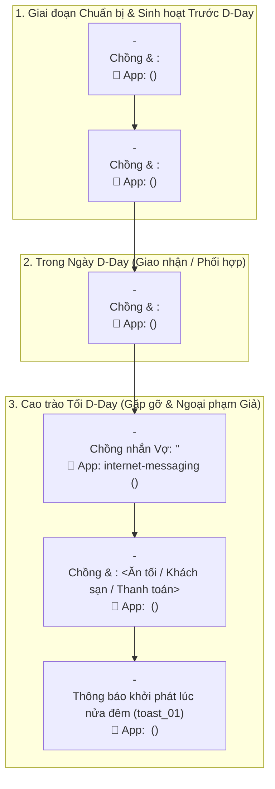
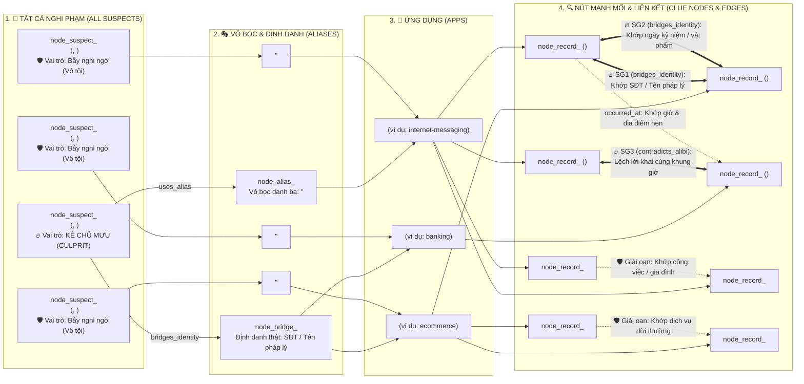

# Storyboard & Sơ đồ Pháp y - Màn <N>: <Tên Màn Chơi>

> **Thẩm quyền Tác giả**: Được thiết kế bởi `level-designer`. Tái sử dụng hồ sơ gốc tại [husband-profile.md](husband-profile.md). Tài liệu này định nghĩa nhân khẩu học của các nghi phạm, kịch bản tương tác theo dòng thời gian (Storyboard), sơ đồ Timeline và sơ đồ mạng lưới nối kết Manh mối - Nghi phạm trước khi viết dữ liệu thoại chi tiết.

---

## 1. Hồ sơ Nhân khẩu học Nghi phạm & Nhân vật Trong Màn (Suspect & Cast Personas)

*Kế thừa chân dung chồng, vợ và nhân vật cố định từ [husband-profile.md](husband-profile.md). Mọi hội thoại tiếng Việt bắt buộc tuân thủ chuẩn xưng hô tiếng Việt tự nhiên (`anh/em/chị/cô/chú/bác/con/mày/tao`) theo đúng độ tuổi, giới tính, thứ bậc xã hội/gia đình và mối quan hệ thực tế với người chồng (chồng `<tuổi_chồng>` tuổi):*

| ID Nhân vật / Nghi phạm | Họ tên Thật | Tuổi & Giới tính | Nghề nghiệp & Nhân khẩu học | Quan hệ với Chồng & Cách xưng hô chuẩn | Vỏ bọc trong máy (`alias`) | Khẩu khí & Thói quen ngôn ngữ (`chatTone`) | Vai trò trong Màn |
|---|---|---|---|---|---|---|---|
| `suspect_<id>` | <Họ tên thật> | <Tuổi, Nữ/Nam> | <Nghề nghiệp, nơi ở, hoàn cảnh> | <Nhỏ/lớn hơn chồng bao nhiêu tuổi; xưng hô tự nhiên> | `<Tên lưu danh bạ/app>` | <Mức độ viết tắt, từ lóng, văn phong> | **Kẻ chủ mưu (Culprit)** |
| `suspect_<id>` | <Họ tên thật> | <Tuổi, Nữ/Nam> | <Nghề nghiệp, nơi ở, hoàn cảnh> | <Quan hệ công việc/gia đình/dịch vụ; xưng hô tự nhiên> | `<Tên lưu danh bạ/app>` | <Mức độ viết tắt, từ lóng, văn phong> | Bẫy nghi ngờ (Red Herring) |
| `contact_<id>` | <Họ tên thật> | <Tuổi, Nữ/Nam> | <Nghề nghiệp, hoàn cảnh> | <Quan hệ sinh hoạt đời thường; xưng hô tự nhiên> | `<Tên lưu danh bạ/app>` | <Mức độ viết tắt, từ lóng, văn phong> | Sinh hoạt / Giải oan |

---

## 2. Kịch bản Tương tác Theo Dòng thời gian (Chronological Interaction Storyboard)

*Liệt kê theo trình tự thời gian từ quá khứ gần đến thời điểm kiểm tra máy (`D-Day`). Bao gồm cả chuỗi sự kiện vụ án (`EVT-*`) và hoạt động sinh hoạt/giải oan đời thường (`ACT-*`):*

| Thứ tự / ID | Thời điểm | Chồng tương tác với ai | Họ làm gì cùng nhau / cho nhau (ăn uống, mua sắm, công việc, khách sạn, chuyển tiền, chat...) | Địa điểm & Vật phẩm trao tay (Ai giữ trước -> sau) | Qua Ứng dụng nào (`appId`) | Mã Bản ghi / Manh mối sinh ra (`Record ID` / `Clue ID`) | Sự thật ngầm vs Vỏ bọc hiển thị |
|---|---|---|---|---|---|---|---|
| `EVT-01` | <Ngày Giờ> | <Nhân vật> | <Hành động tương tác cụ thể> | <Địa điểm / Vật phẩm> | `<appId>` | `<record_id>` (`<CLUE-ID>`) | <Sự thật tác giả biết vs điều vợ thấy trên máy> |
| `ACT-01` | <Ngày Giờ> | <Nhân vật> | <Hoạt động sinh hoạt / nhờ vả vô tội> | <Địa điểm / Vật phẩm> | `<appId>` | `<record_id>` (Sinh hoạt / Giải oan) | <Lý do vô tội hợp lý> |

---

## 3. Sơ đồ Dòng thời gian Cốt truyện & Dấu vết Ứng dụng (Mermaid Story Timeline Diagram)

*Sơ đồ trực quan hóa trình tự thời gian của vụ án, ai tương tác với chồng, làm việc gì và để lại dấu vết trên ứng dụng nào:*

---

## 4. Sơ đồ Mạng lưới Nghi phạm -> Vỏ bọc -> Ứng dụng -> Nút Manh mối (Mermaid Clue & Suspect Graph)

*Sơ đồ phục vụ trực tiếp cho việc lập trình `CaseKnowledgeGraph` (`nodes[]` và `edges[]`), bố cục từ Trái sang Phải theo đúng 4 cột (`ALL_SUSPECTS -> ALIASES -> APPS -> CLUE_NODES`):*
1. **Cột 1 (`ALL_SUSPECTS`)**: Container gom toàn bộ nghi phạm thật trong màn (chia rõ Kẻ chủ mưu và Nhóm nghi phạm bẫy/vô tội).
2. **Cột 2 (`ALIASES`)**: Các vỏ bọc danh bạ, tài khoản ngụy trang hoặc tên pháp lý (`node_alias_*` / `node_bridge_*`) mà từng nghi phạm sử dụng.
3. **Cột 3 (`APPS`)**: Các ứng dụng nơi vỏ bọc/danh tính đó xuất hiện.
4. **Cột 4 (`CLUE_NODES`)**: Các nút bản ghi manh mối (`node_record_*`) sinh ra từ ứng dụng đó, nối trực tiếp với nhau (`Clue <--> Clue`) bằng các cạnh ghi rõ loại liên kết (`bridges_identity`, `contradicts_alibi`, `occurred_at`, hoặc đối chiếu giải oan).

